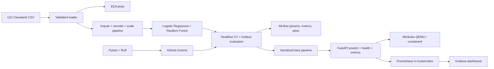

# Heart Disease MLOps Learning Project

This repository is a runnable learning scaffold for the AIMLCZG523 Assignment 01. It demonstrates a reproducible data-to-API workflow using the UCI Heart Disease dataset. It is **not** a clinical tool and must not be used to make medical decisions.

> **Academic integrity and evidence:** The current folder includes measured results and screenshots from a real local run. Review and understand them, personalize your implementation/report, and record your own walkthrough video. No public cloud deployment or GitHub Actions run is claimed. Complete `REPORT_TEMPLATE.md` using your own explanation and add your repository URL before submitting.

## What the assignment asks you to do

| Assignment task | Where this scaffold addresses it | What you still need to demonstrate |
| --- | --- | --- |
| 1. Data acquisition and EDA (5) | `scripts/download_data.py`, `src/heart_ml/data.py`, `scripts/eda.py` | Interpret the generated plots and missingness in your own words. |
| 2. Feature engineering and models (8) | `src/heart_ml/pipeline.py`, `src/heart_ml/train.py` | Explain model selection and metric trade-offs from actual results. |
| 3. Experiment tracking (5) | MLflow runs and artifacts emitted by `train.py` | Review the actual runs in the local UI and explain them. |
| 4. Packaging and reproducibility (7) | scikit-learn preprocessing pipeline, joblib model, `requirements.txt` | Record your environment and understand the end-to-end pipeline. |
| 5. CI/CD and tests (8) | `.github/workflows/ci.yml`, `tests/` | Push to your own GitHub repository and capture a successful workflow run. |
| 6. Containerization (5) | `Dockerfile`, `docker-compose.yml` | Review and understand the local build/run evidence. |
| 7. Deployment (7) | `deployment/minikube-stack.yaml`, `kustomization.yaml` | Local Minikube/QEMU stack; no public cloud deployment. |
| 8. Monitoring/logging (3) | API metrics and Kubernetes-hosted Prometheus/Grafana | Verify the API scrape target and dashboard. |
| 9. Report (2) | `REPORT_TEMPLATE.md` | Complete your analysis, add your repository URL, and export/check the 10-page report. |

## 1. Prerequisites

- Python 3.10–3.13
- Git
- Minikube, QEMU, and kubectl for the recommended Minikube workflow (Docker Desktop and Colima are not required)
- Docker Engine and Docker Compose v2 only if you choose the optional Compose workflow

The first-time setup below uses a virtual environment. On macOS/Linux:

```bash
python3 -m venv .venv
source .venv/bin/activate
python -m pip install --upgrade pip
python -m pip install -r requirements.txt
python -m pip install -e ".[dev]"
```

On Windows PowerShell, create/activate with `py -m venv .venv` and `.venv\Scripts\Activate.ps1`, then run the same pip commands.

The recommended Minikube setup uses QEMU and containerd, so it does not
require a Docker Engine on the Mac. See
[deployment/MINIKUBE_MIGRATION.md](deployment/MINIKUBE_MIGRATION.md) for the
complete setup and deployment walkthrough.

## 2. Download and inspect data

Download the original Cleveland subset from the UCI Machine Learning Repository:

```bash
python scripts/download_data.py
```

The source file is `data/raw/heart.csv`. The script downloads the official UCI archive and extracts `processed.cleveland.data`; it does not silently replace an existing file. Review UCI's dataset documentation and cite the source in your report.

Create the cleaned, normalized CSV with the binary target:

```bash
python scripts/prepare_data.py
```

This writes `data/processed/heart_cleaned.csv`. The source's six unknown feature values are preserved as missing values in this file; the model pipeline imputes them inside each training fold to avoid preprocessing leakage.

Data preparation and model preprocessing happen at different points by design. The preparation script handles dataset-level work such as column normalization, unknown-value recognition, and binary target creation. Imputation, scaling, and categorical encoding are fitted as part of the model pipeline after each training split. Fitting those steps on the whole dataset before splitting would leak information from validation/holdout data into training and would make inference less consistent.

Generate exploratory plots:

```bash
python scripts/eda.py
```

Outputs go to `reports/figures/`: feature histograms, a correlation heatmap for continuous numeric features and target, and a target-class balance chart. Categorical fields are omitted from Pearson correlation because their integer codes are category labels, not continuous measurements. The target in the raw data is `num` (0 = no disease, 1–4 = disease); preprocessing maps 1–4 to positive class 1. The Cleveland file uses `?` for unknown values; the data loader preserves those as missing so the fitted preprocessing pipeline can impute them.

## 3. Train, compare, and track experiments

```bash
python -m heart_ml.train --data data/raw/heart.csv --output models
```

The command uses a stratified holdout split and compares Logistic Regression and Random Forest. Its pipeline derives two numeric features from age and maximum heart rate: heart-rate reserve (`220 - age - thalach`) and the fraction of estimated maximum heart rate (`thalach / (220 - age)`). These use the common 220-minus-age heuristic, which is an approximate feature transformation, not a validated medical measure. A small grid search with cross-validation is performed using training data only; within each fold the pipeline creates these features, imputes missing values, one-hot encodes categorical columns, and scales numeric columns. This keeps preprocessing fitted only on each training fold and avoids leakage. The best mean cross-validation ROC-AUC selects the model. Holdout accuracy, precision, recall, ROC-AUC, and confusion matrix are recorded for inspection.

The best fitted preprocessing-plus-model pipeline is saved as both `models/heart_model.joblib` and `models/heart_model.pkl`; results, hyperparameter-search tables, and plots are written under `reports/` and logged to MLflow. Each comparison run logs its best parameters, CV/holdout metrics, search grid, tuning results, candidate pipeline, cleaned dataset, EDA figures, confusion matrix, ROC curve, training metadata/software versions, and `requirements.txt`. The dedicated `selected_model` run logs the selected-model metrics and summary, evaluation plots and tuning results, cleaned dataset and EDA figures, plus final `.joblib` and `.pkl` files and environment requirements. In the MLflow run's **Artifacts** tab, use `model/`, `data/`, `eda/`, `environment/`, `metrics/`, `metadata/`, `plots/`, and `tuning/`; comparison runs also have `pipeline/`. Only load serialized files from sources you trust. Run metadata is stored in `mlflow.db`, and run artifacts are stored under `mlruns/`.

Start the experiment UI in another terminal:

```bash
mlflow ui --backend-store-uri sqlite:///mlflow.db --host 127.0.0.1 --port 5000
```

Open <http://127.0.0.1:5000>. Compare the actual runs and note the parameter/metric trade-offs in your report. A small classic dataset can yield unstable estimates; do not present a single split as proof of clinical performance.

## 4. Tests and lint

```bash
ruff check src tests scripts
ruff format --check src tests scripts
pytest
```

Tests use generated, clearly synthetic rows and do not imply that the UCI dataset was downloaded or training succeeded. The GitHub Actions workflow downloads and prepares the UCI data, runs EDA/training, and uploads dataset/model/run artifacts when its jobs succeed.

## 5. Run the API locally

Train first, then:

```bash
uvicorn heart_ml.api:app --host 127.0.0.1 --port 8000
```

Interactive API documentation is at <http://127.0.0.1:8000/docs>, health at `/health`, and Prometheus metrics at `/metrics`. Example request (all 13 input features are required):

```bash
curl -X POST http://127.0.0.1:8000/predict \
  -H 'Content-Type: application/json' \
  -d '{"age":63,"sex":1,"cp":3,"trestbps":145,"chol":233,"fbs":1,"restecg":0,"thalach":150,"exang":0,"oldpeak":2.3,"slope":1,"ca":0,"thal":3}'
```

The response includes the binary prediction, confidence in the predicted class, and positive-class probability. Request logs deliberately omit the submitted patient features. This demo is not an authenticated, privacy-hardened or clinically validated service.

The API listens only on the local machine when started with the command above. In the Minikube deployment, use the API port-forward command in the [Minikube guide](deployment/MINIKUBE_MIGRATION.md) to reach <http://localhost:8000>; this is a local endpoint, not a public cloud URL. If using the optional Compose workflow, its API is also reachable at <http://localhost:8000>.

## 6. Deploy the whole serving stack to Minikube

The recommended local deployment runs the API, Prometheus, and Grafana inside a
QEMU-backed Minikube cluster. Docker Desktop and Colima are not needed. Follow
the [Minikube migration and verification guide](deployment/MINIKUBE_MIGRATION.md)
for installation, model training, in-cluster image build, manifests, Grafana
credentials, port forwarding, testing, and cleanup.

The root `kustomization.yaml` builds ConfigMaps from the project monitoring
configuration and dashboard. Apply the full stack with:

```bash
kubectl apply -f deployment/minikube-namespace.yaml
kubectl apply -k .
```

The API, Prometheus, and Grafana Services are cluster-internal. Use
`kubectl port-forward` as explained in the migration guide to access them from
the Mac. The older `deployment/k8s.yaml` remains an API-only LoadBalancer
manifest for compatibility with the previous local Kubernetes workflow.

## 7. Optional Docker Compose alternative

If Docker Desktop or Colima is available and you prefer Compose, train the model
first and run:

```bash
docker-compose up --build
```

This optional workflow runs the API, Prometheus, and Grafana on local ports
8000, 9090, and 3000, respectively. Stop it with `Ctrl+C` and
`docker-compose down`. The API image installs only inference dependencies from
`requirements-api.txt`.

## 8. Before submission

1. Read `REPORT_TEMPLATE.md` and replace each prompt with your actual findings, decisions, limitations, and sources.
2. Run the data, EDA, training, tests, API, Minikube, and monitoring commands yourself; preserve the outputs you choose to report.
3. Push the project to a GitHub repository you own. Confirm the Actions workflow succeeds on your repository.
4. Existing Docker, Kubernetes, MLflow and monitoring screenshots are in `screenshots/`; review them and capture your own Minikube/CI screenshots after verifying the current setup.
5. Record your short walkthrough video yourself and include its location/link per your course submission rules.
6. Verify that your report is about 10 pages after exporting it to the required PDF/DOCX format. No PDF is generated from placeholders here.

## Project layout

## Architecture



```text
.
├── .github/workflows/ci.yml
├── deployment/minikube-stack.yaml
├── deployment/MINIKUBE_MIGRATION.md
├── kustomization.yaml
├── monitoring/                 # Prometheus and Grafana starter config
├── scripts/                     # UCI download and EDA entry points
├── src/heart_ml/                # data, preprocessing, training and API
├── tests/
├── REPORT_TEMPLATE.md
├── Dockerfile
├── docker-compose.yml
└── requirements.txt
```

## Limitations

This educational example binarizes the UCI target and does not establish medical risk, fairness, calibration, or generalization to other populations. The small, historical dataset and its missing values constrain conclusions. Do not expose this demo to the public internet or use it for clinical care.
