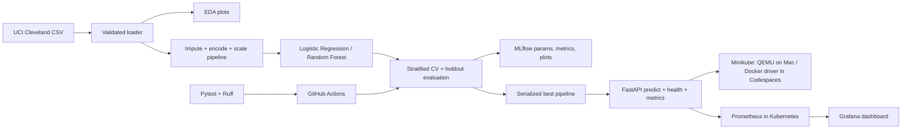

# Heart Disease MLOps Learning Project

This project is for AIMLCZG523 Assignment 01. It shows how to prepare the UCI Heart Disease data, train and track models, and deploy a prediction API with Kubernetes. It is a learning project, not a medical tool.

> **Before submitting:** Run the steps yourself, make sure you understand the results, and write the report in your own words. Add your repository URL and record your own walkthrough video. In `screenshots/`, files prefixed with `codespaces-` are from Codespaces; other screenshots are from earlier local runs.

## Assignment tasks covered

| Task | Project files or tools | What to include in your submission |
| --- | --- | --- |
| Data and EDA | `scripts/`, `src/heart_ml/data.py` | Explain the plots and data preparation. |
| Models and tracking | `src/heart_ml/train.py`, MLflow | Explain model choice and results. |
| Tests and CI | `tests/`, `.github/workflows/ci.yml` | Show test and workflow results. |
| API and deployment | `Dockerfile`, `deployment/`, `kustomization.yaml` | Show API and monitoring checks. |
| Report | `REPORT_TEMPLATE.md` | Complete and export the report as required. |

## Quick guide

For the main Codespaces workflow, follow these sections in order:

1. [Set up Python and Minikube](#github-codespaces-setup)
2. [Download and prepare the data](#2-download-and-inspect-data)
3. [Train the models](#3-train-compare-and-track-experiments)
4. [Run tests](#4-tests-and-lint)
5. [Deploy the API and monitoring tools](#6-deploy-the-whole-serving-stack-to-minikube)

The MLflow browser page, direct API run, macOS setup, and Docker Compose are optional. You do not need them for the Codespaces Minikube deployment.

## 1. Set up the environment

- Python 3.12 (used in Codespaces and CI)
- Git
- Minikube and kubectl (installed in the Codespaces steps below)

### GitHub Codespaces setup

Use Python 3.12 for this project. In a Codespaces terminal, run:

```bash
sudo apt-get update
sudo apt-get install -y python3.12 python3.12-venv
cd /workspaces/MLOps-Assignment-01
python3.12 -m venv .venv
source .venv/bin/activate
python --version
python -m pip install --upgrade pip
python -m pip install -r requirements.txt
python -m pip install -e ".[dev]"
```

Check that `python --version` prints Python 3.12.x. Keep using this terminal with `.venv` active when you run the project commands.

Install Minikube and start the Kubernetes cluster:

```bash
curl -LO https://storage.googleapis.com/minikube/releases/latest/minikube-linux-amd64
sudo install minikube-linux-amd64 /usr/local/bin/minikube
rm minikube-linux-amd64
minikube start --driver=docker --container-runtime=containerd \
  --cpus=2 --memory=4096 --disk-size=20g
minikube status
kubectl config current-context
kubectl get nodes
```

Wait for the node to show `Ready` before continuing.

<details>
<summary>If the Minikube node does not become Ready</summary>

Codespaces may be able to download an image with Docker even when Minikube cannot. If the `kindnet` pod shows `ImagePullBackOff`, run:

```bash
kubectl get pods -n kube-system
kubectl describe pod -n kube-system -l k8s-app=kindnet
KINDNET_IMAGE=$(kubectl get pod -n kube-system -l k8s-app=kindnet \
  -o jsonpath='{.items[0].spec.containers[0].image}')
docker pull "$KINDNET_IMAGE"
minikube image load "$KINDNET_IMAGE"
kubectl delete pod -n kube-system -l k8s-app=kindnet
kubectl get nodes
```

Wait for the node to show `Ready`. If it still does not, check `kubectl describe node minikube` and `minikube logs --problems`.

</details>

### Local setup (optional)

The rest of this section is only needed if you are not using Codespaces.

On macOS or Linux, create a virtual environment and install the dependencies:

```bash
python3 -m venv .venv
source .venv/bin/activate
python -m pip install --upgrade pip
python -m pip install -r requirements.txt
python -m pip install -e ".[dev]"
```

On Windows PowerShell, create and activate the environment with `py -m venv .venv` and `.venv\Scripts\Activate.ps1`, then run the same pip commands.

For the macOS Minikube setup, see [deployment/MINIKUBE_MIGRATION.md](deployment/MINIKUBE_MIGRATION.md).

## 2. Download and inspect data

Download the original Cleveland subset from the UCI Machine Learning Repository:

```bash
python scripts/download_data.py
```

This downloads the Cleveland dataset to `data/raw/heart.csv`. Cite the UCI dataset in your report.

Create the cleaned, normalized CSV with the binary target:

```bash
python scripts/prepare_data.py
```

This creates `data/processed/heart_cleaned.csv`. Unknown values are kept as missing here and filled by the model pipeline during training.

The preparation step cleans column names and changes the original target into two classes: `0` (no disease) and `1` (disease). The model pipeline handles missing values, scaling, and category encoding.

Generate exploratory plots:

```bash
python scripts/eda.py
```

The charts are saved in `reports/figures/`. They show feature distributions, correlations, and the number of examples in each class.

## 3. Train, compare, and track experiments

```bash
python -m heart_ml.train --data data/raw/heart.csv --output models
```

The script compares Logistic Regression and Random Forest using cross-validation, then evaluates the selected model on a held-out test set. It saves accuracy, precision, recall, ROC-AUC, and plots so you can review the results. Preprocessing is fitted as part of the model pipeline.

The model is saved under `models/`, reports and plots under `reports/`, and experiment data in `mlflow.db` and `mlruns/`. The dataset is small, so results may vary and should not be treated as clinical evidence.

Training saves runs to MLflow but does not open a browser page. **Optional:** To view the runs in Codespaces, open a second terminal at the repository root and run:

```bash
source .venv/bin/activate
python -m mlflow ui --backend-store-uri sqlite:///mlflow.db --host 0.0.0.0 --port 5000
```

Leave this terminal open and open port `5000` in the Codespaces **Ports** tab. The UI shows runs saved in this Codespace. If there are no runs, train the model first. You can skip this optional step and continue with deployment.

## 4. Tests and lint

```bash
ruff check src tests scripts
ruff format --check src tests scripts
pytest
```

These commands check code style and run the tests. The GitHub Actions workflow also runs data preparation and model training.

<details>
<summary>Optional: run the API directly without Kubernetes</summary>

This standalone development option is not part of the Minikube workflow below.
Train the model first, then run the API process directly on the host:

```bash
uvicorn heart_ml.api:app --host 127.0.0.1 --port 8000
```

Interactive API documentation is at <http://127.0.0.1:8000/docs>, health at `/health`, and Prometheus metrics at `/metrics`. Example request (all 13 input features are required):

```bash
curl -X POST http://127.0.0.1:8000/predict \
  -H 'Content-Type: application/json' \
  -d '{"age":63,"sex":1,"cp":3,"trestbps":145,"chol":233,"fbs":1,"restecg":0,"thalach":150,"exang":0,"oldpeak":2.3,"slope":1,"ca":0,"thal":3}'
```

The response includes the binary prediction, confidence in the predicted class, and positive-class probability. Request logs deliberately omit the submitted patient features. This demo is not an authenticated, privacy-hardened or clinically validated service.

The local Uvicorn command is only for running the API directly during
development. It is not needed for the Minikube deployment: Kubernetes starts
the API container, and `kubectl port-forward` provides access to it.

</details>

## 6. Deploy the whole serving stack to Minikube

Minikube runs the API, Prometheus, and Grafana. Before deploying, complete the data, training, and test steps above in the same Codespace. The API image needs the trained model file from `models/`.

### GitHub Codespaces (Minikube Docker driver)

Build the API image and load it into Minikube:

```bash
docker build -t heart-disease-api:local .
minikube image load heart-disease-api:local
minikube image ls | grep heart-disease-api
```

Create the namespace and a local Grafana credential, then deploy:

```bash
kubectl apply -f deployment/minikube-namespace.yaml
read -rsp "Choose a local Grafana admin password: " GRAFANA_PASSWORD
echo
kubectl create secret generic grafana-admin \
  --namespace mlops \
  --from-literal=admin-user=admin \
  --from-literal=admin-password="$GRAFANA_PASSWORD" \
  --dry-run=client -o yaml | kubectl apply -f -
unset GRAFANA_PASSWORD

kubectl apply -k .
kubectl rollout status deployment/heart-disease-api -n mlops --timeout=180s
kubectl rollout status deployment/prometheus -n mlops --timeout=180s
kubectl rollout status deployment/grafana -n mlops --timeout=180s
kubectl get pods,services -n mlops
```

For a later model retrain, rebuild and load the API image, then restart the
existing API Deployment so its pod uses that image:

```bash
docker build -t heart-disease-api:local .
minikube image load heart-disease-api:local
kubectl rollout restart deployment/heart-disease-api -n mlops
kubectl rollout status deployment/heart-disease-api -n mlops --timeout=180s
```

Kubernetes normally pulls the Prometheus and Grafana images automatically, so
try applying the manifests first. Only if either pod is stuck in
`ImagePullBackOff` because the Minikube node cannot reach Docker Hub, pull the
images through the Codespace Docker daemon and load them into Minikube. Then
delete the failing pods so their Deployments recreate them:

```bash
docker pull prom/prometheus:v2.55.1
docker pull grafana/grafana:11.3.0
minikube image load prom/prometheus:v2.55.1
minikube image load grafana/grafana:11.3.0
kubectl delete pod -n mlops -l app=prometheus
kubectl delete pod -n mlops -l app=grafana
kubectl rollout status deployment/prometheus -n mlops --timeout=180s
kubectl rollout status deployment/grafana -n mlops --timeout=180s
```

The Services are `ClusterIP` and are accessed through port-forwarding. Run
each command in a separate Codespaces terminal and keep the terminals open:

```bash
kubectl port-forward --address 0.0.0.0 -n mlops service/heart-disease-api 8000:8000
kubectl port-forward --address 0.0.0.0 -n mlops service/prometheus 9090:9090
kubectl port-forward --address 0.0.0.0 -n mlops service/grafana 3000:3000
```

In the Codespaces **Ports** tab, open ports 8000, 9090, and 3000; keep them
private. The API root `/` returns 404 because no root route is defined. Use
`/docs` for Swagger UI or `/health` for a health check. Verify the API and
Prometheus scrape from another terminal:

```bash
curl -i http://127.0.0.1:8000/health
curl -sS -X POST http://127.0.0.1:8000/predict \
  -H 'Content-Type: application/json' \
  -d '{"age":63,"sex":1,"cp":3,"trestbps":145,"chol":233,"fbs":1,"restecg":0,"thalach":150,"exang":0,"oldpeak":2.3,"slope":1,"ca":0,"thal":3}'
curl -sS 'http://127.0.0.1:9090/api/v1/query?query=up%7Bjob%3D%22heart-disease-api%22%7D'
```

Health should return HTTP 200 and the Prometheus query should report `1`.
Open the forwarded Grafana port, sign in as `admin` using the password created
above, and view **MLOps Demo → Heart Disease API**. Send API requests and allow
time for scraping before expecting dashboard panels to show data.

Stop each port-forward with Ctrl+C. To stop the cluster while preserving its
resources, run `minikube stop`. Do not run `docker compose up` for this Minikube
workflow; Compose is a separate deployment option.

### Local macOS Minikube (QEMU driver)

On macOS, use the QEMU-based setup and image build described in the
[Minikube migration and verification guide](deployment/MINIKUBE_MIGRATION.md).
That environment is separate from a Codespace.

The root `kustomization.yaml` builds ConfigMaps from the project monitoring
configuration and dashboard. The older `deployment/k8s.yaml` remains an
API-only LoadBalancer manifest for compatibility with the previous local
Kubernetes workflow. The current complete stack uses internal ClusterIP
Services and port-forward access; it is not a public-cloud deployment.

## 7. Optional Docker Compose alternative

If Docker Desktop or Colima is available and you prefer Compose, train the model
first and run:

```bash
docker compose up --build
```

This optional alternative runs the API, Prometheus, and Grafana on local ports
8000, 9090, and 3000, respectively. Stop it with Ctrl+C or run
`docker compose down`. The API image installs only inference dependencies from
`requirements-api.txt`.

## 8. Before you submit

1. Complete `REPORT_TEMPLATE.md` in your own words. Include your repository link and the results you observed.
2. Review the `codespaces-` screenshots in `screenshots/`. Other screenshots in that folder document earlier local runs.
3. Push the project to your GitHub repository and check that its Actions workflow passes.
4. Record your walkthrough video and export the report to the format and page count required by your course.

## Project layout

## Architecture



```text
.
├── .github/workflows/ci.yml
├── deployment/minikube-stack.yaml
├── deployment/MINIKUBE_MIGRATION.md
├── kustomization.yaml
├── monitoring/                 # Prometheus and Grafana starter config
├── scripts/                     # UCI download and EDA entry points
├── src/heart_ml/                # data, preprocessing, training and API
├── tests/
├── REPORT_TEMPLATE.md
├── Dockerfile
├── docker-compose.yml
└── requirements.txt
```

## Limitations

This educational example binarizes the UCI target and does not establish medical risk, fairness, calibration, or generalization to other populations. The small, historical dataset and its missing values constrain conclusions. Do not expose this demo to the public internet or use it for clinical care.
