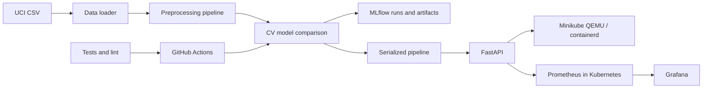

# MLOps Experimental Learning Assignment 01 — Report Template

> Complete this report from your own runs. Replace every `[TODO]` with evidence or your analysis; delete this instruction before submission. Do not claim runs, metrics, deployment, screenshots, or a public URL that you did not produce. Export to PDF/DOCX and check that the final document meets the assignment's 10-page requirement.

## Cover page

- Course: AIMLCZG523 — Machine Learning Operations
- Assignment: 01
- Student name / ID: [TODO]
- Repository URL: [TODO]
- Date: [TODO]

## 1. Executive summary

[TODO: State the prediction task, what you implemented, the best model selected on your actual experiment, and the most important limitations. Avoid framing predictions as diagnosis.]

## 2. Problem framing and data provenance

[TODO: Describe the binary prediction question and intended educational use. Cite the UCI Machine Learning Repository Heart Disease dataset, identify the Cleveland subset/file, and state when/how you downloaded it. Explain that raw target values 1–4 map to positive.]

## 3. Reproducible setup and architecture

The verified run used macOS on Apple Silicon (ARM64), Python 3.13.5, Minikube 1.39.0 with its QEMU2 driver, and Kubernetes v1.37.0 using containerd. Docker Desktop and Colima were not used for the Minikube image build or cluster deployment. Model training and MLflow tracking ran locally in the project's Python environment; the trained model was packaged into the API image. Reproduce with the setup and commands in `deployment/MINIKUBE_MIGRATION.md`.

## 4. Data cleaning and EDA

The downloaded Cleveland subset contained 303 rows and 13 input features plus the target. After mapping raw target values 1–4 to positive class 1, this run had 164 negative and 139 positive examples. The raw `?` markers represented 4 missing `ca` values and 2 missing `thal` values; the pipeline imputes those values during model fitting. The delivered normalized binary-target CSV is `data/processed/heart_cleaned.csv`; its missing feature entries are intentionally preserved until fold-fitted imputation. Generated plots are `reports/figures/class_balance.png`, `reports/figures/feature_histograms.png`, and `reports/figures/correlation_heatmap.png`.

[TODO: Insert and interpret your generated feature histograms and correlation heatmap; the figures are in `reports/figures/`.]

[TODO: Interpret the observed distributions, target balance, correlations and missingness in your own words. Correlation is exploratory, not causal.]

## 5. Features and model development

The pipeline derives two approximate heart-rate features from age and maximum heart rate, median-imputes and standardizes numeric features, and mode-imputes and one-hot encodes categorical features. These transformations are fitted inside each model pipeline and CV fold. Logistic Regression searched `C` in `{0.1, 1.0, 10.0}`; Random Forest searched `max_depth` in `{None, 5, 10}` and `min_samples_leaf` in `{1, 3}`. Per-candidate results are recorded in `reports/logistic_regression_tuning.csv` and `reports/random_forest_tuning.csv`.

[TODO: Explain why the feature treatment and search ranges make sense, or what you would change.]

| Model | CV ROC-AUC mean (and spread) | Holdout accuracy | Precision | Recall | ROC-AUC |
|---|---:|---:|---:|---:|---:|
| Logistic Regression | 0.9008 (SD 0.0145) | 0.8852 | 0.8387 | 0.9286 | 0.9665 |
| Random Forest | 0.8914 (SD 0.0257) | 0.8689 | 0.8333 | 0.8929 | 0.9578 |

The selection rule chose Logistic Regression because its mean training-fold CV ROC-AUC was higher. It also had higher scores on each reported holdout metric in this particular split. The small dataset and single holdout split still make these estimates uncertain.

[TODO: Explain whether you agree with this selection rule, the precision/recall trade-off for this educational task, and why accuracy alone is insufficient.]

## 6. Experiment tracking and packaging

The MLflow experiment `heart-disease-classification` contains separate Logistic Regression and Random Forest runs, with best parameters, five-fold cross-validation and holdout metrics, search grids/results, cleaned data, EDA figures, ROC and confusion-matrix plots, candidate pipeline artifacts, training metadata, software versions and `requirements.txt`. A dedicated `selected_model` run logs the selected metrics and summary, evaluation plots and tuning results, cleaned data/EDA figures, and `heart_model.joblib` and `heart_model.pkl` under its `model/` artifact folder. The local UI is available at `http://localhost:5000` while the MLflow UI process is running; its store is `sqlite:///mlflow.db`. A screenshot from the actual local experiment view is [here](./screenshots/mlflow-experiments.png). The best end-to-end preprocessing/model pipeline is saved locally in both formats and reuses the same imputers, encoders and scaler at inference.

[TODO: Explain the parameter and metric trade-offs from the runs in your own words.]

## 7. Testing and CI/CD

The local validation run passed Ruff checks/formatting and all 13 pytest tests. Tests cover UCI/named CSV loading, missing-value preservation and target mapping, cleaned CSV export, EDA figure generation, both model pipelines, API predictions, categorical input validation and metrics. The GitHub Actions workflow is configured to lint, test, download and clean data, run EDA, train, and upload run artifacts.

[TODO: The workflow has not been run in your own GitHub repository yet. Add your repository Actions URL/screenshot after pushing and describe the actual result; do not imply this local check was a GitHub Actions run.]

## 8. API and container

The API validates all 13 input fields and returns the binary prediction, predicted-class confidence and positive-class probability. In the verified Minikube run, the sample request returned HTTP 200 with `prediction: 0`, `confidence: 0.9217`, and `positive_probability: 0.0783`; this response matched the locally saved selected model. The inference image built successfully inside Minikube's containerd image store, and the API's `/health`, `/predict` and `/metrics` endpoints returned HTTP 200. Request logging records path/status/latency but does not include submitted feature values.

[TODO: Explain the response schema and privacy trade-off in your own words.]

## 9. Deployment and monitoring

The API, Prometheus and Grafana were deployed as Kubernetes workloads to the local QEMU-backed Minikube cluster using `deployment/minikube-stack.yaml` and `kubectl apply -k .`. All three pods reached 1/1 readiness. Their Services are `ClusterIP` and were exposed on loopback with `kubectl port-forward`. The API `/health`, `/predict` and `/metrics` endpoints returned HTTP 200; Prometheus reported `up=1` for `heart-disease-api:8000`, and Grafana reported a healthy API response with the provisioned Prometheus datasource and `Heart Disease API` dashboard. Configuration and the reproducible steps are documented in [deployment/MINIKUBE_MIGRATION.md](./deployment/MINIKUBE_MIGRATION.md).

Minikube evidence captured from the verified local stack: [API docs](./screenshots/minikube-api-docs.png), [Prometheus target (`1/1 up`)](./screenshots/minikube-prometheus-targets.png), and [Grafana request/latency dashboard](./screenshots/minikube-grafana-dashboard.png). Earlier local evidence is also available: [Kubernetes API docs](./screenshots/kubernetes-api-docs.png) and [Grafana dashboard](./screenshots/grafana-dashboard.png).

[TODO: Explain what the live request and latency panels showed. This is a local deployment, not a public cloud service. Add any course-required workflow/CI screenshots after running CI in your own repository.]

## 10. Limitations, ethics, and conclusion

[TODO: Discuss small/historical dataset, missing data, target simplification, class and population bias, lack of calibration/clinical validation, privacy/security, and how you would improve the system. Summarize what you learned.]

## References

- UCI Machine Learning Repository, Heart Disease dataset: https://archive.ics.uci.edu/dataset/45/heart+disease (accessed [TODO]).
- [TODO: Add any additional tools, papers, or references used, following your course citation requirements.]

## Evidence checklist

- [x] EDA figures produced by the project run
- [x] Actual MLflow runs visible
- [ ] CI workflow screenshot/link from my own repository
- [x] API image build and local Kubernetes deployment proof (Minikube/QEMU)
- [x] Prometheus API scrape and Grafana provisioning verified in Minikube
- [x] Capture Minikube API, Prometheus target, and Grafana dashboard screenshots
- [x] Monitoring dashboard screenshot
- [ ] Short pipeline walkthrough video recorded by me
- [ ] Final document exported and checked for the required page count
