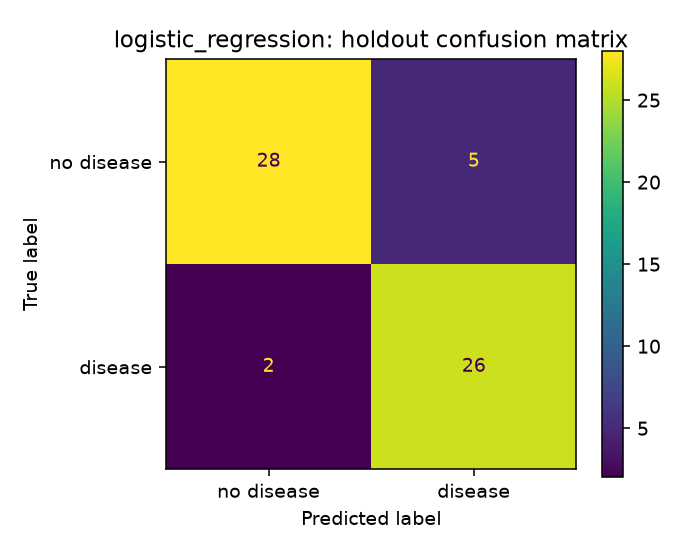
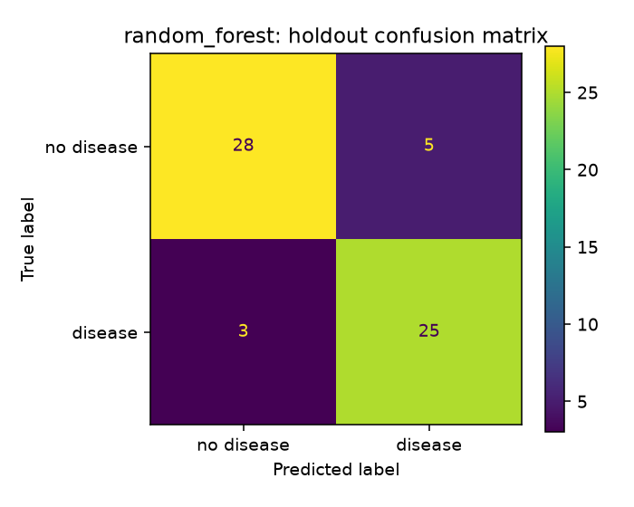
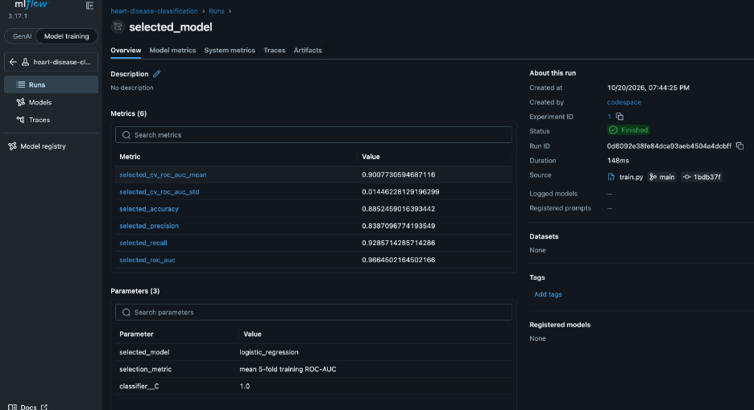
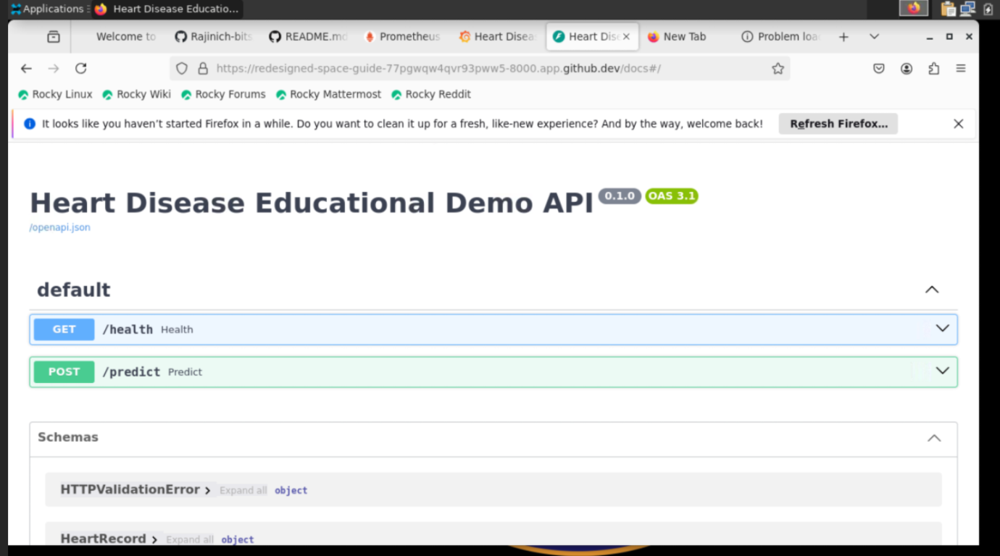
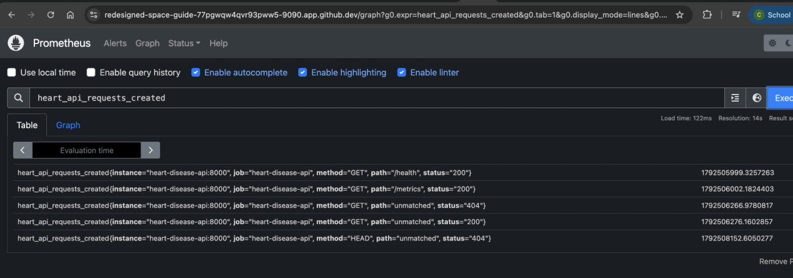
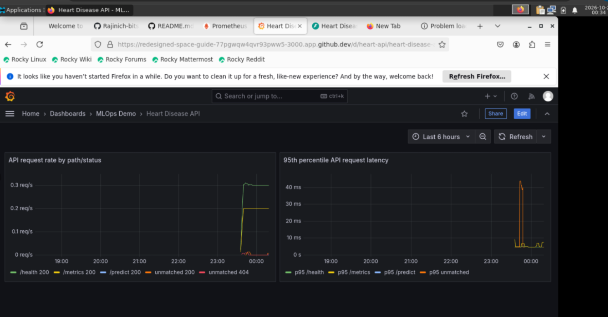
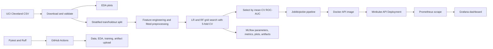

# Heart Disease MLOps Experimental Learning Assignment

## Assignment 01 — AIMLCZG523

| Report detail | Value |
| --- | --- |
| Student name | **Rajini Chowdana** |
| Student ID | **2025ae05371** |
| Repository | [Rajinich-bits/MLOps-Assignment-01](https://github.com/Rajinich-bits/MLOps-Assignment-01) |
| Report date | 20 October 2026 |
| Deployment type | GitHub Codespaces with Minikube Docker driver; no public cloud deployment |

> **Educational-use notice:** This project is an experimental learning example, not a medical device. Its predictions must not be used for diagnosis, treatment, or other clinical decisions.

## 1. Executive summary

This project implements a reproducible machine-learning workflow for a binary classification experiment on the Cleveland subset of the UCI Heart Disease dataset. The raw target has values 0 through 4; this project maps 0 to the negative class and values greater than 0 to the positive class. The workflow downloads and prepares the data, generates exploratory plots, evaluates Logistic Regression and Random Forest, logs experiments to MLflow, saves a fitted preprocessing/model pipeline, and serves predictions through FastAPI.

The model-selection criterion is mean five-fold cross-validation ROC-AUC on the training partition. In the recorded run, Logistic Regression was selected with mean CV ROC-AUC 0.9008 (standard deviation 0.0145). Its holdout ROC-AUC was 0.9665 and accuracy was 0.8852. These estimates are based on a small, historical dataset and a single holdout split; they do not establish clinical performance or generalization.

The serving stack consists of an API container, Prometheus, and Grafana deployed to Minikube using Kubernetes YAML manifests and Kustomize. The verified deployment was run in GitHub Codespaces using the Docker driver. The API returned HTTP 200 from `/health`, and Prometheus reported the API target as up (`1`). Grafana's health endpoint returned HTTP 200, its pod was running, and the Grafana browser UI is now working in Codespaces.

## 2. Problem statement and data provenance

The experiment asks whether the supplied patient measurements can be used by a classifier to distinguish the dataset's binary target classes. The output is a model classification, not a diagnosis or estimate validated for clinical use.

The source is the [UCI Machine Learning Repository Heart Disease dataset](https://archive.ics.uci.edu/dataset/45/heart+disease), using the processed Cleveland subset (`processed.cleveland.data`). The downloaded file is `data/raw/heart.csv`. The project includes `scripts/download_data.py` to obtain the archive and extract the Cleveland file, and `scripts/prepare_data.py` to normalize columns and map the original `num` target to a binary `target` (`0` means original `num` is 0; `1` means original `num` is greater than 0).

The dataset has 303 rows, 13 input features, and one target. The normalized class counts in the recorded dataset are:

| Binary target | Meaning | Rows |
| --- | --- | ---: |
| 0 | No disease indicated by the original target | 164 |
| 1 | Original target greater than 0 | 139 |
| **Total** |  | **303** |

The source uses `?` to denote unknown values in `ca` and `thal`: four missing values in `ca` and two in `thal` were observed. The cleaned CSV preserves these unknowns as missing values. Imputation is performed within the fitted model pipeline rather than by estimating imputation values on the full dataset before cross-validation.

## 3. Reproducible setup

### 3.1 Python environment and data workflow

The project uses Python 3.10 or later; CI and the recorded Codespaces setup use Python 3.12. In Codespaces, Python 3.14 was present by default, so Python 3.12 and its virtual-environment support were installed. From the repository root:

```bash
sudo apt-get update
sudo apt-get install -y python3.12 python3.12-venv
cd /workspaces/MLOps-Assignment-01
python3.12 -m venv .venv
source .venv/bin/activate
python --version
python -m pip install --upgrade pip
python -m pip install -r requirements.txt
python -m pip install -e ".[dev]"
```

Prepare the dataset, generate the EDA figures, run tests/lint, and train the models:

```bash
if [ ! -f data/raw/heart.csv ]; then python scripts/download_data.py; fi
python scripts/prepare_data.py
python scripts/eda.py
ruff check src tests scripts
ruff format --check src tests scripts
pytest -q
python -m heart_ml.train --data data/raw/heart.csv --output models
```

The training script produces the fitted artifacts under `models/`, evaluation results under `reports/`, and MLflow tracking data in `mlflow.db` and `mlruns/`. These are generated locally and are excluded from Git by the project's `.gitignore`; training should be rerun in a clean Codespace before building the API image. MLflow logging occurs during training. Starting the MLflow UI is optional and is not required to deploy or test the API.

### 3.2 Codespaces Minikube deployment

The deployment uses Minikube's Docker driver inside the Codespace. Ensure Minikube reports a `Ready` node before proceeding:

```bash
minikube start --driver=docker --container-runtime=containerd \
  --cpus=2 --memory=4096 --disk-size=20g
minikube status
kubectl config current-context
kubectl get nodes
```

After model training, the Codespace Docker daemon successfully built the API image. Loading that image into Minikube makes it available to the cluster:

```bash
docker build -t heart-disease-api:local .
minikube image load heart-disease-api:local
```

The Minikube node encountered DNS timeouts when fetching some images directly from Docker Hub. This was a conditional recovery, not a normal prerequisite. If Prometheus or Grafana shows `ImagePullBackOff`, pull the images with Docker and load them into Minikube, then delete the failing pods so their Deployments retry:

```bash
docker pull prom/prometheus:v2.55.1
docker pull grafana/grafana:11.3.0
minikube image load prom/prometheus:v2.55.1
minikube image load grafana/grafana:11.3.0
kubectl delete pod -n mlops -l app=prometheus
kubectl delete pod -n mlops -l app=grafana
```

The same type of DNS failure initially affected the Kubernetes `kindnet` image and left the node `NotReady`. In that case, inspect the current pod's image reference and events first; the image tag can change:

```bash
kubectl get pods -n kube-system
kubectl describe pod -n kube-system -l k8s-app=kindnet
```

When the Minikube node cannot fetch the image but Docker in Codespaces can, pull and load the exact image shown by the pod, then recreate it:

```bash
KINDNET_IMAGE=$(kubectl get pod -n kube-system -l k8s-app=kindnet \
  -o jsonpath='{.items[0].spec.containers[0].image}')
docker pull "$KINDNET_IMAGE"
minikube image load "$KINDNET_IMAGE"
kubectl delete pod -n kube-system -l k8s-app=kindnet
kubectl get nodes
```

The application stack is deployed into the `mlops` namespace. A local Grafana password is kept in a Kubernetes Secret, not in the manifest:

```bash
kubectl apply -f deployment/minikube-namespace.yaml
read -rsp "Choose a local Grafana admin password: " GRAFANA_PASSWORD
echo
kubectl create secret generic grafana-admin \
  --namespace mlops \
  --from-literal=admin-user=admin \
  --from-literal=admin-password="$GRAFANA_PASSWORD" \
  --dry-run=client -o yaml | kubectl apply -f -
unset GRAFANA_PASSWORD

kubectl apply -k .
kubectl rollout status deployment/heart-disease-api -n mlops --timeout=180s
kubectl rollout status deployment/prometheus -n mlops --timeout=180s
kubectl rollout status deployment/grafana -n mlops --timeout=180s
kubectl get pods,services -n mlops
```

The root `kustomization.yaml` generates ConfigMaps for Prometheus and Grafana provisioning and dashboard files. `deployment/minikube-stack.yaml` defines the API, Prometheus, and Grafana Deployments and `ClusterIP` Services. In Codespaces, each service is forwarded from its own terminal:

```bash
kubectl port-forward --address 0.0.0.0 -n mlops service/heart-disease-api 8000:8000
kubectl port-forward --address 0.0.0.0 -n mlops service/prometheus 9090:9090
kubectl port-forward --address 0.0.0.0 -n mlops service/grafana 3000:3000
```

Codespaces exposes the forwarded ports through the Ports panel. Keep these demo services private. Port 8000's `/` path returns 404 because the API does not define a root route; `/docs` and `/health` are valid browser paths.

## 4. Exploratory data analysis

The EDA script writes class-balance, feature-histogram, and correlation figures to `reports/figures/`.

### Class balance


The two classes are relatively close in size (164 negative and 139 positive rows), though the data are not perfectly balanced. Stratified splitting and stratified five-fold cross-validation preserve class proportions across partitions. The class balance does not imply that the sample is representative of any current clinical population.

### Feature distributions


The histograms show a mixture of continuous measurements and integer-coded categorical variables. For example, age is concentrated in middle-to-older adult ranges in this sample, while `cp`, `slope`, `ca`, and `thal` have discrete categories. Several input distributions are skewed or concentrated in a small number of values. Integer-coded categorical fields should not be interpreted as continuous scales.

### Numeric correlation heatmap


The plotted Pearson correlations include only continuous numeric measurements and the target; categorical code values are excluded. In this dataset, `thalach` has a negative correlation with the target (approximately -0.42), while `oldpeak` has a positive correlation (approximately 0.42). `age` has a smaller positive correlation (approximately 0.22). These are descriptive linear associations in this dataset only; they do not demonstrate causality or clinical importance.

## 5. Feature engineering and model development

The model input includes 13 original features: `age`, `sex`, `cp`, `trestbps`, `chol`, `fbs`, `restecg`, `thalach`, `exang`, `oldpeak`, `slope`, `ca`, and `thal`. The pipeline categorizes `sex`, `cp`, `fbs`, `restecg`, `exang`, `slope`, `ca`, and `thal` as categorical; the remaining original inputs are treated as numeric.

Two approximate numeric features are added from age and maximum heart rate:

- Heart-rate reserve: `(220 - age) - thalach`
- Fraction of estimated maximum heart rate: `thalach / (220 - age)`

These use the commonly used 220-minus-age heuristic and are exploratory engineered features, not validated medical measurements. Numeric features are median-imputed and standardized. Categorical features are imputed with the most frequent value and one-hot encoded with unknown categories ignored. The transformations are in the same scikit-learn pipeline as the classifier, so they are fitted on each training fold and reused consistently at inference time.

The training procedure uses a stratified 80/20 train/holdout split with random state 42. Hyperparameters are selected with stratified five-fold cross-validation on the training partition using ROC-AUC. Logistic Regression searches `C` in `{0.1, 1.0, 10.0}`. Random Forest searches `max_depth` in `{None, 5, 10}` and `min_samples_leaf` in `{1, 3}`; it uses 200 trees, a fixed seed, and balanced class weights.

### Recorded model results

| Model | Selected parameters | CV ROC-AUC mean (SD) | Holdout accuracy | Holdout precision | Holdout recall | Holdout ROC-AUC |
| --- | --- | ---: | ---: | ---: | ---: | ---: |
| Logistic Regression | `C=1.0` | 0.9008 (0.0145) | 0.8852 | 0.8387 | 0.9286 | 0.9665 |
| Random Forest | `max_depth=5`, `min_samples_leaf=1` | 0.8914 (0.0257) | 0.8689 | 0.8333 | 0.8929 | 0.9578 |

The model-selection rule selects Logistic Regression because it had the higher mean five-fold training ROC-AUC. In this single holdout split it also achieved higher reported accuracy, precision, recall, and ROC-AUC. For the selected Logistic Regression model, the holdout confusion matrix was 28 true negatives, 5 false positives, 2 false negatives, and 26 true positives. The Random Forest matrix was 28 true negatives, 5 false positives, 3 false negatives, and 25 true positives.





The higher recall in this run means Logistic Regression missed fewer positive examples in this holdout set, while its precision shows that some negative examples were predicted positive. Neither metric determines what operating threshold would be appropriate for a medical setting. The dataset is too small and limited to support that decision. Accuracy alone would hide the different false-positive and false-negative counts; ROC-AUC and class-specific metrics provide additional information, but remain uncertain estimates.

## 6. Experiment tracking and model packaging

The training script logs runs to the MLflow experiment `heart-disease-classification`. It creates separate Logistic Regression and Random Forest runs and a `selected_model` run. Logged run information includes model and tuning parameters, five-fold CV and holdout metrics, training metadata and software versions, search grids and tuning tables, cleaned data, EDA figures, confusion matrices, ROC curves, candidate pipelines, and the selected model artifacts. The final fitted pipeline is saved as both `models/heart_model.joblib` and `models/heart_model.pkl`.

MLflow records tracking metadata in `mlflow.db` and file artifacts under `mlruns/` for a local run. Training writes the selected metrics to `reports/metrics.json`, per-model metrics JSON files, tuning CSVs, and evaluation plots. MLflow UI startup is optional and was not required by the successful Codespaces API/Prometheus deployment checks. Generated model and tracking files are ignored by Git, so a fresh Codespace must download/train locally before it can build the API image.

The following screenshot shows the completed `selected_model` run in Codespaces:



The fitted artifact is a complete preprocessing-plus-classifier pipeline rather than a bare estimator. This preserves feature engineering, missing-value imputation, scaling, and categorical encoding at inference. Joblib and pickle artifacts should only be loaded from sources the user trusts.

## 7. Testing and CI/CD

The project has pytest unit tests for data loading and preprocessing, target mapping and missing-value handling, EDA figure generation, model pipelines, and API behavior and validation. The repository's CI workflow, `.github/workflows/ci.yml`, is configured to:

1. Check out the repository and set up Python 3.12.
2. Install runtime and development dependencies.
3. Run Ruff lint and formatting checks.
4. Run pytest.
5. Download and prepare the UCI dataset.
6. Generate EDA figures and train/log the experiments.
7. Upload model, report, dataset, MLflow, and plot artifacts when available.

The workflow triggers on pushes, pull requests, and manual dispatch. Configuration in the repository is not proof that a workflow run succeeded. [Actions page](https://github.com/Rajinich-bits/MLOps-Assignment-01/actions)

### CI evidence


Repository Actions URL: <https://github.com/Rajinich-bits/MLOps-Assignment-01/actions>


## 8. API and containerization

The FastAPI service exposes `/health`, `/predict`, and `/metrics`; interactive schema and request documentation is available at `/docs`. The prediction request contains all 13 required input features. A successful sample response has the shape:

```json
{
  "prediction": 0,
  "confidence": 0.9216677921443284,
  "positive_probability": 0.07833220785567167
}
```

That sample value came from a prior recorded run and should not be presented as a fixed output for a newly trained model. The response gives the predicted binary class, confidence for that predicted class, and probability of the positive class. Request logging records endpoint/status/latency metrics while deliberately omitting submitted feature values. This is not a complete privacy, authentication, or security design.

The Dockerfile uses `python:3.12-slim`, installs inference-only dependencies from `requirements-api.txt`, and copies the application source and trained joblib model into the API image. In Codespaces, the image was built using the Codespace Docker daemon and loaded into Minikube with `minikube image load`; the Kubernetes Deployment runs the containerized API. No separate host API-server command is part of this deployment workflow.

## 9. Kubernetes deployment and monitoring

The complete Kubernetes stack is described by `deployment/minikube-stack.yaml` and `kustomization.yaml`. It includes Deployments and internal `ClusterIP` Services for the API, Prometheus, and Grafana, along with generated ConfigMaps for scraping, the datasource, the dashboard provider, and the dashboard. Grafana credentials are provided through a Kubernetes Secret. The stack uses ephemeral storage for Prometheus and Grafana, so pod recreation can discard their runtime history/state.

The verified Codespaces environment was Ubuntu 24.04.5 LTS, x86-64, with 2 CPUs and approximately 7.8 GiB RAM. The Codespace provided Docker Engine 29.8.0 and Docker Compose 5.5.1. Python 3.12 was installed and used in the project's virtual environment; Minikube used its Docker driver and containerd. Kubernetes reported version v1.37.0. The node initially remained `NotReady` because it could not resolve Docker Hub to pull `kindnet`; pulling the image through the Codespace Docker daemon, loading it into Minikube, and allowing the pod to restart resolved the issue.

The API image built successfully with `docker build` and was loaded into Minikube using `minikube image load`. Prometheus and Grafana initially encountered image-pull failures in the Minikube node; pulling those images through Docker and loading them into Minikube allowed their pods to start. The API pod reached `Running`, `/health` returned HTTP 200, and Prometheus returned `up=1` for `heart-disease-api:8000`. Grafana's `/api/health` returned HTTP 200, and its browser UI is now working in Codespaces.

### Codespaces deployment and monitoring screenshots

These screenshots document the Codespaces run. The browser bars are included to show the forwarded Codespaces service addresses.

**API documentation (`/docs`):**



**Prometheus API request metrics:**



**Grafana API monitoring dashboard:**



Other images in `screenshots/` without the `codespaces-` prefix are from earlier local project runs and should not be described as Codespaces evidence.

### Prometheus/Grafana monitoring design

Prometheus scrapes the API `/metrics` endpoint through the Kubernetes Service DNS name `heart-disease-api:8000`. The provisioned Grafana dashboard queries `heart_api_requests_total` for request rates grouped by path and status, and `heart_api_request_duration_seconds_bucket` for p95 request latency. In Codespaces, Prometheus's `up` metric was `1` for the API target, and the Grafana browser UI is working.

## 10. Architecture



## 11. Limitations, ethics, and conclusion

This work demonstrates engineering practices on a small historical dataset; it does not establish that the model is safe or useful in health care. Important limitations include:

- **Small, dated sample:** 303 Cleveland-subset rows are insufficient to characterize current or diverse patient populations.
- **Target simplification:** Original severity values 1–4 are collapsed into a single positive class, discarding severity distinctions.
- **Missingness:** Six unknown feature values are imputed; the strategy may not reflect the clinical meaning or mechanism of missingness.
- **Population and measurement bias:** Dataset collection, feature definitions, and representation may limit generalization and create uneven errors across groups.
- **Uncertainty and validation:** A single stratified holdout and five-fold CV on the same small dataset do not replace external validation, calibration, confidence intervals, prospective studies, or clinical review.
- **Feature heuristic:** The age-adjusted heart-rate transformations use a rough population heuristic and are not clinical measurements.
- **Security and privacy:** The demonstration API has no authentication, uses a local demo deployment, and is not hardened for sensitive health information or internet exposure.
- **Operational persistence:** Prometheus and Grafana use ephemeral storage in the Minikube manifest; this is suitable for a demonstration but not durable production monitoring.
- **Deployment scope:** Minikube and Codespaces port forwarding are local demonstration environments. No public cloud deployment or public production URL is claimed.

The project demonstrates a full path from dataset download through model evaluation, experiment logging, container packaging, Kubernetes deployment, and API monitoring. The main engineering decision is to keep preprocessing inside the training pipeline to avoid leakage and preserve identical transformations at inference. The results support Logistic Regression for this particular recorded split under the chosen ROC-AUC criterion, but the dataset limitations prohibit medical conclusions. A production-oriented follow-up would require representative approved data, subgroup evaluation, calibration and external validation, secure identity and access controls, durable monitoring storage, and clinical governance.

## References

1. UCI Machine Learning Repository. [Heart Disease dataset](https://archive.ics.uci.edu/dataset/45/heart+disease). Cleveland subset.
2. Scikit-learn documentation. [Pipelines and composite estimators](https://scikit-learn.org/stable/modules/compose.html).
3. MLflow documentation. [Tracking](https://mlflow.org/docs/latest/ml/tracking/).
4. Kubernetes documentation. [Deployments](https://kubernetes.io/docs/concepts/workloads/controllers/deployment/) and [Services](https://kubernetes.io/docs/concepts/services-networking/service/).
5. Prometheus documentation. [Overview](https://prometheus.io/docs/introduction/overview/).
6. Grafana documentation. [Dashboards](https://grafana.com/docs/grafana/latest/dashboards/).

## Submission checklist

- [x] Setup and reproducible data/training commands documented
- [x] EDA plots and recorded model metrics included
- [x] Experiment tracking and model artifact behavior described
- [x] Architecture diagram included
- [x] Deployment and monitoring screenshots linked
- [x] Student name and ID entered
- [x] Successful GitHub Actions run screenshot included
- [x] Codespaces API, Prometheus, and rendered Grafana screenshots added if required
- [x] Student walkthrough video recorded
- [ ] Report exported to the required format and checked against the 10-page requirement
